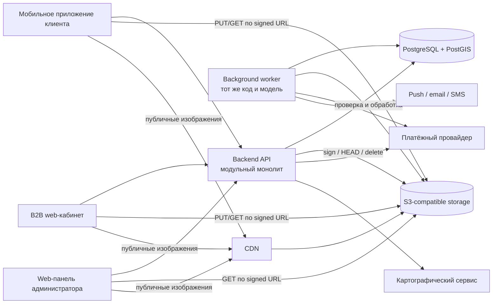
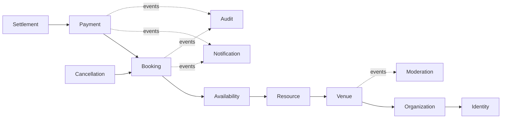
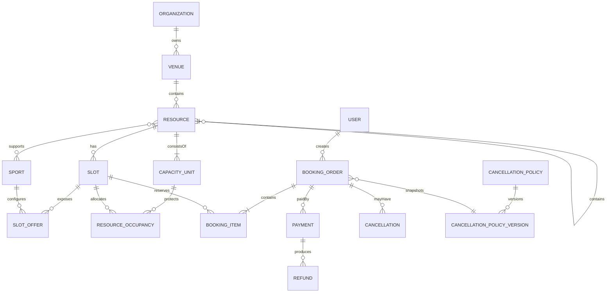
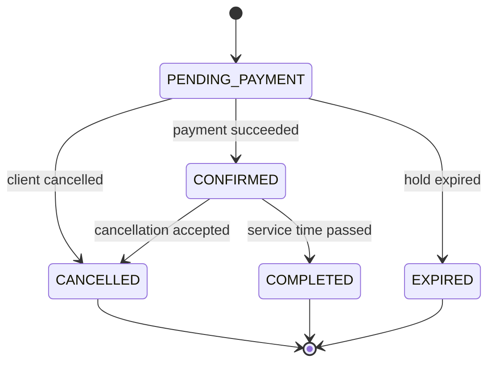

# Архитектура backend-системы «Погнали»

**Область:** клиентское мобильное приложение, B2B web-кабинет площадки, web-панель администратора и внешние интеграции.

**Статус:** целевая архитектура MVP. Текущий код является стартовым каркасом: в нём реализованы сборка, системный API, Flyway, PostGIS, Spring Security и проверка границ Spring Modulith. Доменные модули, outbox, worker, Testcontainers, OpenTelemetry и структурированные логи добавляются соответствующими вертикальными срезами, а не считаются уже реализованными.

## 1. Назначение документа

Документ фиксирует исходную архитектуру backend-системы «Погнали», принятые решения, бизнес-инварианты и вопросы, которые должны быть согласованы до реализации отдельных модулей.

Архитектура рассчитана на MVP и последующее масштабирование.

## 2. Исходные требования и допущения

Подтверждено:

- первым городом запуска является Омск;
- клиент использует мобильное приложение;
- представитель площадки использует web-кабинет;
- административный контур реализуется как web-интерфейс;
- один владелец может управлять несколькими спортивными комплексами;
- карточка площадки проходит модерацию до публикации;
- бронируемым объектом является физический ресурс: зал, корт, поле, дорожка или другая зона;
- один ресурс может поддерживать несколько видов спорта;
- слоты заранее создаются представителем площадки;
- бронь подтверждается автоматически после успешной оплаты;
- слот удерживается на время оплаты в течение 10 минут;
- разрешено бронирование нескольких слотов одной площадки в одном заказе;
- оплата должна поддерживать банковские карты и СБП;
- чеки и фискализация обязательны;
- отзывы и рейтинги не входят в MVP, но должны быть учтены в границах модели;
- бронирование от имени команды или компании не входит в MVP.

Рабочие допущения до отдельного согласования:

- backend предоставляет единый REST API для мобильного приложения, B2B-кабинета и административной панели;
- на старте PostgreSQL является источником истины по доступности слотов;
- внешняя синхронизация расписания не входит в MVP;
- в MVP используется полная онлайн-предоплата;
- в MVP действует автоматическое подтверждение бронирования после оплаты;
- карта не обязательна, но поиск и сортировка по расстоянию входят в модель;
- инфраструктура и персональные данные размещаются на территории России; требование должно быть подтверждено юридически.

## 3. Архитектурные принципы

1. **Модульный монолит вместо микросервисов.** MVP разворачивается как одно приложение с чёткими модульными границами.
2. **Бизнес-правила находятся в доменной модели.** Контроллеры и persistence-слой не определяют допустимые переходы состояний.
3. **PostgreSQL обеспечивает окончательную целостность.** Проверка двойного бронирования выполняется не только в приложении, но и транзакционно в базе данных.
4. **Модули не обращаются напрямую к внутренним таблицам и классам друг друга.** Взаимодействие выполняется через публичные интерфейсы и доменные события.
5. **Платёжные и коммуникационные провайдеры подключаются через адаптеры.** Доменная модель не зависит от конкретного поставщика.
6. **Асинхронные действия доставляются надёжно.** Уведомления, аудит и аналитические события публикуются через transactional outbox.
7. **Наблюдаемость является частью архитектуры.** Для критичных операций используются correlation ID, метрики и структурированные журналы.

## 4. Технологический стек

| Область | Решение |
|---|---|
| Язык | Kotlin/JVM |
| Runtime | актуальная LTS-версия JDK, поддерживаемая выбранной версией Spring Boot |
| Framework | Spring Boot 4.x, Spring MVC |
| Модульность | Spring Modulith |
| Сборка | Gradle Kotlin DSL |
| API | REST/JSON, OpenAPI 3 |
| Безопасность | Spring Security |
| Основная БД | PostgreSQL |
| Геоданные | PostGIS |
| Миграции | Flyway |
| Persistence | Spring Data JPA; jOOQ или явный SQL для сложных запросов и блокировок |
| Файлы | S3-совместимое объектное хранилище |
| Асинхронность MVP | PostgreSQL transactional outbox и фоновые worker-задачи |
| Тестирование | JUnit 5, Testcontainers, MockK, Spring Modulith Test |
| Наблюдаемость | Spring Boot Actuator, Micrometer/OpenTelemetry, структурированные JSON-логи |
| Поставка | Docker image |

Версии npm, Dart и Gradle-зависимостей фиксируются lock-файлами, Spring-линейка — BOM, Gradle wrapper — версией и SHA-256. До production-поставки Docker-образы фиксируются по digest. Перед обновлением выполняются автоматические тесты и проверка миграций.

## 5. Контекст системы



API и background worker могут запускаться отдельными процессами из одного Docker image. Это позволяет независимо масштабировать HTTP-запросы и фоновые задачи без разделения кодовой базы.

Работа с файлами разделена на два контура:

- **control plane:** клиенты запрашивают у API разрешение на операцию, API проверяет права и выдаёт краткоживущий signed URL;
- **data plane:** клиенты передают байты напрямую в S3-compatible storage или получают публичные изображения через CDN.

Backend не проксирует основной файловый трафик. API управляет подписями, метаданными и удалением объектов, а background worker проверяет загруженные файлы, удаляет служебные метаданные и формирует производные изображения.

## 6. Модули приложения

### 6.1 Identity

Отвечает за:

- пользователей и учётные записи;
- аутентификацию и сессии;
- роли и разрешения;
- подтверждение телефона и email;
- согласия на обработку и передачу персональных данных;
- блокировку и восстановление доступа.

### 6.2 Organization

Отвечает за:

- юридические и организационные данные владельца;
- представителей организации;
- связь пользователя с организацией;
- права управления одним или несколькими объектами;
- документы и статус проверки организации.

### 6.3 Venue

Отвечает за:

- спортивные комплексы;
- адрес, координаты, контакты и фотографии;
- инфраструктуру и характеристики;
- публикацию карточки;
- поддерживаемые виды спорта;
- условия обслуживания и часовой пояс объекта.

### 6.4 Resource

Отвечает за физические бронируемые ресурсы внутри комплекса:

- зал;
- корт;
- поле;
- дорожку;
- бассейн или его часть;
- произвольную зону.

Ресурсы допускают иерархию через `parentResourceId`. Один ресурс может поддерживать несколько видов спорта.

Для конкурентного бронирования ресурс раскладывается на одну или несколько атомарных `CapacityUnit`. Это минимальная физическая секция, которая не может быть занята двумя бронированиями одновременно. Неделимый корт имеет одну такую единицу; делимый зал — несколько. Предложение аренды всего зала требует одновременного занятия всех его единиц, предложение половины зала — соответствующего подмножества. Состав единиц предложения версионируется и не меняется задним числом для существующих слотов.

### 6.5 Availability

Отвечает за:

- рабочее расписание;
- шаблоны массовой генерации слотов;
- заранее созданные слоты;
- блокировки на ремонт или мероприятие;
- предложения слота для разных видов спорта;
- цену и доступность;
- атомарные записи занятости `ResourceOccupancy`, защищающие интервалы `CapacityUnit`.

Availability является единственным владельцем таблиц слотов и занятости. Он публикует синхронный фасад удержания, подтверждения и освобождения интервала. Только реализация этого модуля блокирует или изменяет его таблицы.

### 6.6 Booking

Отвечает за:

- временное удержание одного или нескольких слотов;
- заказ и позиции заказа;
- подтверждение брони;
- истечение удержания;
- отмену и завершение;
- orchestration атомарного удержания через публичный фасад Availability.

Booking владеет заказом и позициями, но не читает и не блокирует таблицы Availability напрямую. Application service Booking начинает одну транзакцию, вызывает синхронный фасад Availability и записывает заказ; при ошибке любая часть транзакции откатывается.

### 6.7 Payment

Отвечает за:

- создание платёжной сессии;
- идемпотентную обработку webhook;
- состояние платежа;
- возвраты;
- связь платежа с бронированием;
- интеграцию с фискализацией.

Модуль зависит от интерфейса `PaymentProvider`, а не от SDK конкретного провайдера.

### 6.8 Settlement

Отвечает за:

- расчёт комиссии агрегатора;
- реестр оплаченных бронирований;
- расчётный период;
- задолженность площадки;
- данные для счёта и сверки.

Полноценный финансовый кабинет не входит в MVP, но минимальный расчётный реестр необходим, если комиссия выставляется площадке раз в месяц.

### 6.9 Cancellation

Отвечает за:

- версионные политики отмены;
- расчёт возвращаемой суммы;
- причины отмены;
- административное решение по спору;
- снимок правил, действовавших при бронировании.

### 6.10 Notification

Отвечает за:

- шаблоны сообщений;
- напоминания;
- уведомления о смене состояния;
- выбор канала;
- историю и повторную доставку.

### 6.11 Moderation и Administration

Отвечают за:

- модерацию площадок и документов;
- публикацию и блокировку;
- управление справочниками;
- административные операции;
- обращения и споры;
- отчётность.

### 6.12 Audit

Хранит неизменяемую историю критичных действий:

- изменение расписания и цены;
- ручное изменение брони;
- отмена и возврат;
- модерационное решение;
- изменение прав доступа.

## 7. Зависимости модулей



Сплошная стрелка `A --> B` означает, что модуль A синхронно зависит от публичного контракта B. Пунктирные связи являются асинхронными событиями. Notification и Audit не участвуют в основной транзакции бронирования. Конкретные зависимости фиксируются через `@ApplicationModule(allowedDependencies = [...])` по мере появления модулей.

## 8. Основная доменная модель



### 8.1 Ресурс и вид спорта

`Resource` — продаваемая конфигурация площадки, `CapacityUnit` — атомарная физическая секция для контроля конфликтов, а вид спорта — вариант использования ресурса.

Пример:

```text
Зал №1
├── волейбол: 2 000 ₽/час
├── баскетбол: 2 500 ₽/час
└── мини-футбол: 3 000 ₽/час
```

Для одного физического интервала создаётся один `Slot` и несколько `SlotOffer`. Выбор предложения не создаёт отдельную доступность: удержание предложения создаёт занятость всех `CapacityUnit`, необходимых этому ресурсу.

Бронирование всего делимого зала занимает все его атомарные секции. Бронирование одной секции не блокирует независимую соседнюю секцию, но конфликтует с одновременной арендой всего зала. Если фактическая схема деления площадки сложнее дерева, она задаётся явным набором `CapacityUnit`, а не вычисляется обходом `parentResourceId` во время бронирования.

### 8.2 Слоты

Слот содержит:

- идентификатор ресурса;
- `startsAt` и `endsAt` как `Instant` в UTC;
- часовой пояс площадки отдельным IANA `ZoneId`, используемым для расписаний и отображения;
- административное состояние `OPEN`, `BLOCKED` или `CANCELLED`;
- версию для optimistic locking;
- предложения по видам спорта и ценам.

Слоты создаются:

- вручную;
- массово по диапазону дат;
- из недельного шаблона;
- копированием расписания.

Изменение шаблона не изменяет существующие брони и не перезаписывает вручную изменённые слоты.

### 8.3 Денежные значения

Деньги хранятся как целое количество минимальных денежных единиц и код валюты:

```text
amountMinor = 250000
currency = RUB
```

Фактические суммы платежей, комиссий и возвратов хранятся в PostgreSQL как `BIGINT`, а в Kotlin — как `Long`. Значение `amountMinor` всегда используется вместе с ISO-кодом валюты, поскольку количество минимальных единиц зависит от валюты.

Бинарные типы с плавающей точкой `float` и `double` запрещены для хранения и расчёта денежных значений. Для ставок, процентов и промежуточных вычислений используются:

- целое количество basis points, если точности достаточно: `3,5% = 350 bp`;
- `BigDecimal` для более сложных формул.

Каждая финансовая формула обязана явно задавать масштаб и правило округления. После расчёта результат переводится в минимальные денежные единицы и сохраняется как целое значение. Правило округления согласуется с платёжной и бухгалтерской моделью до реализации соответствующей операции.

## 9. Состояния

Состояния слота, бронирования, платежа и возврата разделяются. Единое поле `status` для всех процессов не используется.

### 9.1 BookingStatus



### 9.2 PaymentStatus

```text
CREATED → PROCESSING → SUCCEEDED
                    ↘ FAILED
SUCCEEDED → PARTIALLY_REFUNDED → REFUNDED
```

Webhook провайдера является источником подтверждения результата платежа. Возврат имеет собственное состояние и не кодируется только состоянием бронирования.

### 9.3 Расширение способов подтверждения

MVP реализует только `AUTO_AFTER_PAYMENT`. В модели допускаются будущие политики:

- `VENUE_APPROVAL`;
- `PAY_ON_SITE`;
- `PARTIAL_PREPAYMENT`.

Неиспользуемые сценарии не реализуются заранее. Расширение выполняется через интерфейсы `BookingConfirmationPolicy` и `PaymentPolicy`.

## 10. Конкурентное бронирование

Критический инвариант:

> Интервалы двух активных удержаний или подтверждённых броней не могут пересекаться для одной `CapacityUnit`, даже если они созданы из разных слотов или предложений.

Availability хранит для каждой занятой атомарной секции полуоткрытый UTC-интервал `[startsAt, endsAt)` как `tstzrange`. PostgreSQL обеспечивает окончательную гарантию через exclusion constraint:

```sql
EXCLUDE USING gist (
    capacity_unit_id WITH =,
    occupied_period WITH &&
)
WHERE (state IN ('HELD', 'CONFIRMED'))
```

Для совместного GiST-ограничения UUID/числового идентификатора и диапазона требуется заранее установленное расширение `btree_gist`.

Алгоритм удержания:

1. API принимает список слотов и `Idempotency-Key`.
2. Booking начинает транзакцию и вызывает публичный `AvailabilityReservationFacade`.
3. Availability получает состав `CapacityUnit`, сортирует их идентификаторы и блокирует только принадлежащие модулю Availability строки слотов/занятости либо специальные guard-строки в стабильном порядке; таблицы модуля Resource для этого не блокируются.
4. В той же транзакции просроченные конфликтующие удержания переводятся в `EXPIRED`; worker не является единственным механизмом освобождения.
5. Проверяются состояние слота, отсутствие пересекающейся активной занятости и актуальная цена.
6. Availability создаёт `ResourceOccupancy` для каждой атомарной секции; exclusion constraint закрывает гонку между транзакциями.
7. Booking создаёт заказ `PENDING_PAYMENT` до `now + 10 minutes` и позиции со снимком цены, интервала, состава секций и вида спорта.
8. В outbox записывается событие `BookingHeld`.
9. Транзакция фиксируется.

Если хотя бы один слот недоступен, вся операция откатывается. Частичное удержание заказа не допускается.

Уникальность по `slotId` может использоваться дополнительно, но не заменяет проверку пересечения интервалов: разные слоты одного ресурса тоже могут пересекаться. Фоновая задача заранее освобождает просроченные удержания. Проверка срока выполняется также при новом удержании и в транзакции оплаты.

## 11. Платёжный процесс

Предварительный сценарий:

```text
Создание удержания
→ создание платёжной сессии
→ переход пользователя к оплате
→ webhook платёжного провайдера
→ идемпотентная фиксация результата
→ подтверждение брони
→ событие BookingConfirmed
```

Требования:

- каждый входящий webhook имеет уникальный `providerEventId`;
- повторная доставка не создаёт повторных операций;
- HTTP-редирект пользователя не подтверждает оплату;
- исходящие запросы используют идемпотентные ключи;
- секреты webhook проверяются;
- необработанный payload сохраняется в защищённом виде для расследования;
- платёж и подтверждение брони связываются через локальную транзакцию и outbox;
- поздний успешный платёж после истечения удержания обрабатывается отдельным компенсирующим сценарием.

Окончательная последовательность зависит от согласования получателя денег, стороны эквайринга, фискализации и источника средств для возврата.

## 12. Отмена и возврат

Политика отмены является версионной и содержит упорядоченные временные правила:

```text
не менее 24 часов до начала → возврат 100%
от 6 до 24 часов          → возврат 50%
менее 6 часов              → возврат 0%
```

Проценты являются примером и настраиваются площадкой в разрешённых пределах.

При создании брони сохраняются:

- версия политики;
- рассчитанная стоимость;
- применимые условия;
- текст условий для клиента.

Поддерживаются причины и инициаторы:

- клиент;
- площадка;
- администратор;
- техническая отмена;
- спор по неоказанной услуге.

Ручное изменение рассчитанной суммы требует разрешения администратора, причины и записи в аудите.

## 13. API

### 13.1 Правила

- API версионируется префиксом `/api/v1`;
- публичные идентификаторы используют UUID/UUIDv7;
- даты и время передаются в ISO 8601;
- денежные суммы передаются в минимальных единицах с валютой;
- ошибки используют единый формат Problem Details;
- команды создания брони, платежа, отмены и возврата требуют `Idempotency-Key`;
- пагинация выполняется cursor-based для больших изменяемых списков;
- OpenAPI является контрактом для генерации клиентских моделей.

### 13.2 Области API

```text
/api/v1/public/*       каталог и публичные данные
/api/v1/customer/*     профиль и бронирования клиента
/api/v1/partner/*      B2B-операции площадки
/api/v1/admin/*        административные операции
/api/v1/webhooks/*     входящие интеграционные события
```

Разделение URL не заменяет авторизацию: права проверяются на уровне каждого use case и конкретного объекта.

## 14. Данные и поиск

### 14.1 PostgreSQL

Один кластер PostgreSQL используется всеми модулями MVP. Владение таблицами закрепляется за модулями. Прямые запросы к внутренним таблицам другого модуля запрещены в прикладном коде.

Роли базы разделяются:

- `provisioning role` устанавливает PostGIS и `btree_gist`; в production это отдельный инфраструктурный шаг;
- `migration role` изменяет схему через отдельную Flyway job;
- `runtime role` читает и изменяет прикладные данные, но не создаёт расширения и объекты схемы.

В локальном и E2E Compose расширения создаются init-скриптом контейнера, а одна dev-роль может выполнять миграции. В production API запускается с `FLYWAY_ENABLED=false`; успешная migration job является условием выкладки приложения.

### 14.2 Геопоиск

PostGIS используется для:

- хранения координат комплекса;
- фильтрации по радиусу;
- сортировки по расстоянию;
- географических индексов.

Маршруты и дорожное время при необходимости предоставляет внешний картографический сервис. PostGIS рассчитывает географическую близость, а не время поездки.

### 14.3 Поиск каталога

Для MVP используются индексы PostgreSQL и PostGIS. Elasticsearch не вводится до появления подтверждённых ограничений полнотекстового поиска или нагрузки.


## 15. События и transactional outbox

Основные события:

- `OrganizationVerified`;
- `VenueSubmittedForModeration`;
- `VenuePublished`;
- `SlotsGenerated`;
- `BookingHeld`;
- `BookingExpired`;
- `PaymentSucceeded`;
- `PaymentFailed`;
- `BookingConfirmed`;
- `BookingCancelled`;
- `RefundRequested`;
- `RefundSucceeded`.

Доменное изменение и запись события в outbox выполняются одной транзакцией. Worker доставляет событие обработчикам с семантикой at-least-once, поэтому каждый обработчик обязан быть идемпотентным.

Kafka или RabbitMQ могут быть подключены позднее как транспорт без изменения доменных контрактов.

## 16. Безопасность

- короткоживущий access token;
- refresh-сессии с ротацией и возможностью отзыва;
- RBAC с проверкой принадлежности организации и площадки;
- обязательный TLS;
- пароли хранятся только как стойкие хеши;
- секреты не хранятся в репозитории;
- персональные данные маскируются в логах;
- платёжные реквизиты карт не проходят через backend системы;
- административные и финансовые действия журналируются;
- загрузки проверяются по типу, размеру и при необходимости антивирусом;
- применяется rate limiting для входа, восстановления доступа и бронирования;
- согласия пользователя сохраняются с версией документа и временем принятия.

### 16.1 Транспорт сессии и CSRF

- Mobile хранит access/refresh credentials в защищённом хранилище ОС и передаёт access token как `Authorization: Bearer`.
- Web хранит access token только в памяти. Refresh token передаётся отдельной cookie `HttpOnly; Secure; SameSite=Lax` с узким `Path` для refresh/logout endpoint.
- Операции, использующие refresh-cookie, защищаются CSRF-токеном и проверкой `Origin`; CORS разрешает только явный список web-origin и credentials только для этих endpoint.
- Прикладные API с bearer token остаются stateless и не полагаются на UI для проверки ролей.
- Глобальное отключение CSRF запрещено. Исключения допускаются только для endpoint, которые никогда не используют автоматически прикрепляемые browser credentials, и документируются в security-конфигурации.

Конкретные TTL, cookie-domain и политика нескольких устройств фиксируются ADR до реализации Identity.

Юридические требования к локализации, фискализации и передаче данных должны быть подтверждены профильным специалистом до production-запуска.

## 17. Наблюдаемость и аудит

Для каждого запроса используются:

- `traceId` и `correlationId`;
- структурированные журналы без персональных данных;
- latency и error-rate метрики;
- метрики числа удержаний, истечений, подтверждений и конфликтов;
- метрики webhook, повторной доставки и расхождений платежей;
- health/readiness endpoints;
- алерты на рост ошибок оплаты и зависшие удержания.

Бизнес-аудит отделяется от технических логов и имеет собственный срок хранения.

## 18. Тестовая стратегия

Целевые обязательные уровни по мере реализации соответствующих модулей:

1. Unit-тесты доменных правил и переходов состояний.
2. Модульные интеграционные тесты Spring Modulith.
3. Repository-тесты на реальном PostgreSQL/PostGIS через Testcontainers.
4. Конкурентные тесты одновременного удержания одного слота.
5. Contract-тесты платёжного и notification-адаптеров.
6. API-тесты идемпотентности.
7. Миграционные тесты Flyway на пустой базе и копии структуры предыдущей версии.
8. End-to-end сценарий `поиск → удержание → оплата → подтверждение → отмена → возврат`.

Критический приёмочный тест: из нескольких параллельных запросов на один слот ровно один получает успешное удержание.

## 19. Развёртывание и масштабирование

Минимальное production-окружение:

```text
reverse proxy / load balancer
├── backend API: 1+ экземпляр
├── background worker: 1+ экземпляр
├── migration job: однократно перед rollout
├── managed PostgreSQL/PostGIS
└── S3-compatible object storage
```

Приложение не хранит локальное пользовательское состояние и масштабируется горизонтально. API работает под runtime-role без DDL-прав. Фоновые задачи используют блокировку или механизм выбора задач, исключающий одновременную обработку одной записи несколькими worker-процессами.

Границы модулей являются кандидатами на будущее выделение, но не обязательством его выполнить.

## 20. Порядок реализации

1. Каркас приложения, CI, миграции, observability и проверка модульных границ.
2. Identity и Organization.
3. Venue, Resource и Moderation.
4. Availability: расписание, массовая генерация и управление слотами.
5. Booking: удержание, конкурентный доступ и истечение.
6. Payment: провайдер, webhook и идемпотентность.
7. Cancellation и Refund.
8. Notification и напоминания.
9. Settlement и минимальная отчётность.
10. Административные операции, аудит и эксплуатационные отчёты.

## 21. Открытые архитектурные решения

### Блокирующие платёжный модуль

1. Кто юридически принимает оплату: площадка или агрегатор?
2. На чей эквайринговый счёт поступают деньги?
3. Кто формирует кассовый чек?
4. Кто и из каких средств выполняет возврат?
5. Как удерживается комиссия: при платеже или ежемесячным счётом?
6. Как обрабатывается поздняя успешная оплата после истечения удержания?

### Блокирующие интеграцию расписания

1. Является ли система единственным источником истины по слотам?
2. Продолжает ли площадка принимать брони по телефону, через собственный сайт или другие агрегаторы?
3. Нужны ли импорт, API, календарная синхронизация или ручная блокировка внешних броней?

### Требующие уточнения, но не блокирующие каркас

1. Требуется ли обязательная регистрация до просмотра каталога?
2. Используется ли SMS-код для входа или телефон является только контактным полем?
3. Какие уведомления, кроме напоминания, обязательны в MVP?
4. Допускается ли оплата на месте?
5. Какие ограничения применяются к настройке политики отмены?
6. Поддерживается ли одновременное разделение большого зала на независимые секции?
7. Как подтверждаются полномочия представителя организации?

До получения ответов рабочие допущения из раздела 2 считаются временными и должны быть оформлены отдельными ADR перед реализацией соответствующего модуля.

## 22. Критерии пересмотра документа

Архитектура пересматривается при:

- согласовании платёжной и юридической схемы;
- появлении внешней синхронизации расписания;
- добавлении оплаты на месте или частичной предоплаты;
- подтверждении делимых/комбинированных ресурсов;
- существенном изменении состава MVP;
- появлении измеримых ограничений производительности или доступности.
