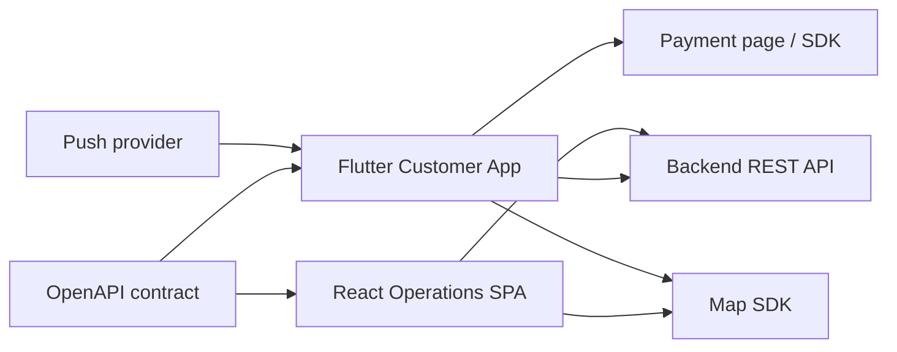
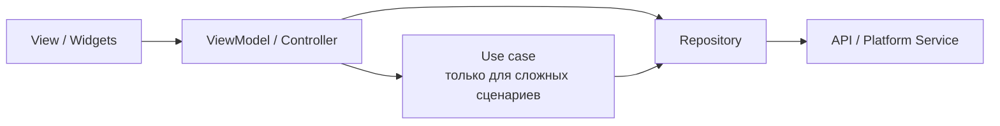
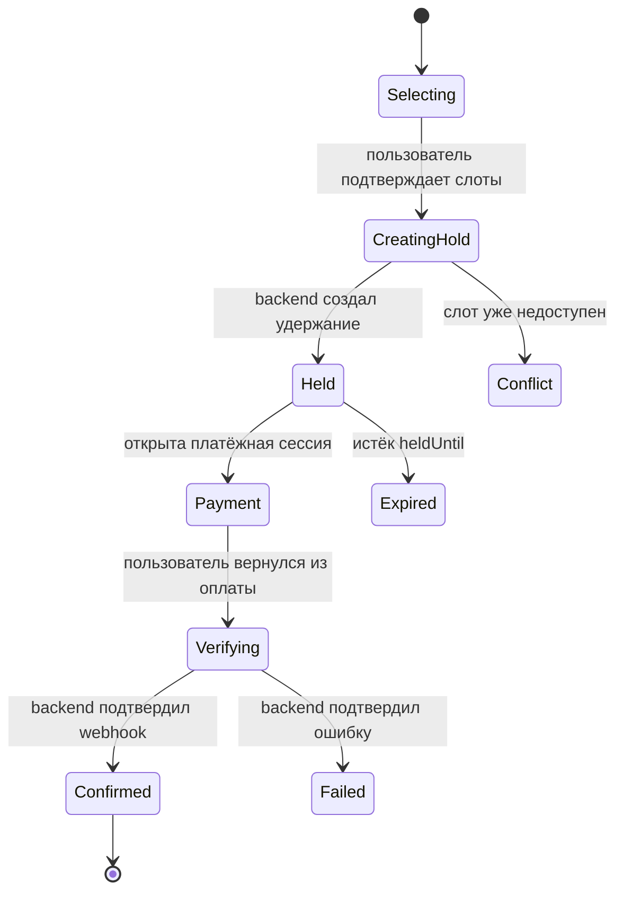

# Архитектура frontend-системы "Погнали"

**Статус:** Draft v0.1
**Дата:** 07.10.2026
**Клиенты:** Flutter-приложение клиента и React web-приложение для
B2B/административных сценариев.

## 1. Назначение документа

Документ фиксирует frontend-архитектуру системы "Погнали", границы приложений,
технологический стек, правила работы с состоянием, API, авторизацией, оплатой и
качеством.

Основная цель - позволить мобильной и web-командам развиваться независимо,
используя единый backend-контракт и одинаковые бизнес-термины.

Frontend не является источником истины для доступности слотов, цены, правил
отмены, платежей и прав доступа. Все критичные решения подтверждает backend.

## 2. Состав frontend-системы

- **Customer Mobile** (Flutter): поиск площадки, выбор слотов, бронирование,
  оплата и управление бронями.
- **Operations Web** (React + TypeScript): кабинет площадки, модерация,
  справочники, споры, возвраты и аудит с разграничением ролей.

Публичный клиентский web-каталог не входит в подтверждённый MVP. При его
появлении он проектируется отдельно с учётом SEO и server-side rendering.

## 3. Ключевые решения

1. Мобильное приложение разрабатывается на Flutter для Android и iOS из одной
   кодовой базы.
2. На старте B2B-кабинет и административная панель поставляются как одно React
   SPA с изолированными маршрутами и проверкой прав на backend. Разделение
   сборок допускается при появлении независимых команд, циклов релиза или
   требований изоляции.
3. Backend, Flutter и React находятся в одном monorepo, но собираются и
   развёртываются независимо.
4. Flutter и React не пытаются переиспользовать исходный UI-код, но используют
   общие дизайн-токены и API-контракт.
5. API-клиенты генерируются из OpenAPI backend-сервиса.
6. Серверное состояние не копируется в глобальные frontend-store без
   необходимости.
7. Бронирование и оплата всегда требуют соединения с backend;
   офлайн-подтверждение запрещено.
8. Скрытие административного UI не считается защитой: полномочия каждой операции
   проверяет backend.

## 4. Общая схема



## 5. Репозиторий

Проект развивается как монорепозиторий:

```text
let_s_go_backend/
|-- backend/    Kotlin/Spring Boot
|-- frontend/   Flutter iOS/Android
|-- web/        React B2B/Admin
|-- docs/       требования, архитектура и OpenAPI
`-- infra/      инфраструктурные манифесты
```

Название корневого каталога историческое и не определяет его текущую роль.
Компоненты не импортируют исходный код друг друга; общая граница проходит через
OpenAPI, дизайн-токены и документированные события.

## 6. Единый API-контракт

Backend публикует версионированную OpenAPI-спецификацию. Из неё генерируются:

- Dart DTO и низкоуровневый API-клиент;
- TypeScript DTO и низкоуровневый API-клиент;
- модели ошибок;
- enum состояний брони, платежа и возврата.

Правила:

- сгенерированный код не редактируется вручную;
- сгенерированные DTO не используются непосредственно во всех UI-компонентах;
- repositories/adapters преобразуют транспортные DTO в модели приложения;
- несовместимое изменение OpenAPI блокирует CI;
- backend публикует `Problem Details` с машинным `code`, пользовательским
  сообщением и `traceId`;
- команды бронирования, платежа, отмены и возврата передают `Idempotency-Key`;
- дата и время передаются в ISO 8601;
- деньги передаются как `amountMinor` и `currency`.

Клиент не вычисляет окончательную цену. Перед удержанием слотов backend
возвращает актуальную стоимость, срок удержания и применённую политику отмены.

## 7. Flutter-приложение

### 7.1 Технологический стек

| Область | Решение |
| --- | --- |
| Framework | Flutter stable |
| Язык | Dart stable, совместимый с выбранной Flutter-версией |
| Архитектура | Feature-first MVVM |
| State management и DI | Riverpod |
| Навигация | `go_router` |
| HTTP | Dio через сгенерированный API-клиент |
| Модели | immutable Dart-модели; code generation при необходимости |
| Secure storage | Keychain на iOS, Keystore-backed storage на Android |
| Простые настройки | `shared_preferences` |
| Локальная БД | не вводится до подтверждения offline-сценариев |
| Локализация | Flutter `gen_l10n` / ARB |
| Аналитика | абстракция `Analytics`, провайдер подключается адаптером |
| Ошибки | Crash/error reporting без персональных данных |

Riverpod используется для жизненного цикла зависимостей и состояния экранов.
Бизнес-правила не размещаются внутри произвольных provider-функций.

### 7.2 Слои

Flutter следует практической MVVM-модели:



- **View** отображает состояние и передаёт пользовательские события.
- **ViewModel** управляет состоянием экрана и вызывает application-операции.
- **Use case** добавляется только для сложных многошаговых сценариев, например
  checkout.
- **Repository** является источником данных для приложения, отвечает за
  преобразование моделей, кэш и повторы.
- **Service** инкапсулирует REST API, secure storage, push, location и другие
  внешние системы.

Отдельный domain-слой не создаётся для простого CRUD. Он используется там, где
действительно есть клиентская логика, а не для механического копирования
backend-DDD.

### 7.3 Структура проекта

```text
lib/
|-- app/
|   |-- bootstrap/
|   |-- navigation/
|   |-- theme/
|   `-- localization/
|-- core/
|   |-- api/
|   |-- auth/
|   |-- errors/
|   |-- observability/
|   |-- storage/
|   `-- widgets/
|-- features/
|   |-- auth/
|   |-- catalog/
|   |-- favorites/
|   |-- venue_details/
|   |-- booking/
|   |-- checkout/
|   |-- payment/
|   |-- my_bookings/
|   |-- profile/
|   `-- notifications/
`-- generated/
    `-- api/
```

Внутренняя структура feature:

```text
feature_name/
|-- data/
|   |-- models/
|   |-- repositories/
|   `-- services/
|-- domain/          только при наличии существенной логики
|-- presentation/
|   |-- screens/
|   |-- widgets/
|   |-- state/
|   `-- view_models/
`-- routes.dart
```

Feature не импортирует внутренние файлы другой feature. Общие публичные
контракты экспортируются явно либо выносятся в `core` только после появления
реального переиспользования.

### 7.4 Навигация

Основные ветки:

```text
/onboarding
/sign-in
/catalog
/venues/:venueId
/checkout/:bookingId
/payment/result
/bookings
/bookings/:bookingId
/favorites
/profile
```

Требования:

- поддержка Android App Links и iOS Universal Links;
- открытие конкретной брони из push-уведомления;
- возврат из браузера или SDK оплаты;
- восстановление состояния после убийства приложения операционной системой;
- авторизационные redirect guards;
- отсутствие критичного состояния только в navigation arguments.

### 7.5 Состояние

Состояние разделяется на:

1. **Server state** - каталог, слоты, брони и профиль; принадлежит
   repositories/query-провайдерам.
2. **Screen state** - выбранные фильтры, шаг формы, loading/error; принадлежит
   ViewModel.
3. **Session state** - текущий пользователь и состояние авторизации; принадлежит
   `SessionRepository`.
4. **Ephemeral UI state** - анимации, раскрытые панели, позиция прокрутки;
   остаётся внутри widgets.

Производные данные вычисляются из исходного состояния и не хранятся второй
копией.

### 7.6 Кэш и offline-поведение

Допускается кэшировать:

- справочники видов спорта;
- ранее просмотренные карточки площадок;
- изображения;
- пользовательские настройки;
- последнюю страницу списка броней для чтения.

Не допускается считать офлайн-данные актуальными для:

- свободных слотов;
- текущей цены;
- срока удержания;
- результата платежа;
- суммы возврата.

При возвращении приложения на foreground активная бронь и платёж перечитываются
с backend.

### 7.7 Геолокация

- разрешение запрашивается только перед функцией, которой оно необходимо;
- отказ не блокирует поиск: пользователь выбирает город или адрес вручную;
- координаты не пишутся в аналитические события без отдельного основания;
- расстояние в каталоге приходит с backend;
- маршрут может строиться внешним картографическим приложением.

## 8. React web-приложения

### 8.1 Технологический стек

| Область | Решение |
| --- | --- |
| UI | React + TypeScript strict |
| Build | Vite |
| Package manager | npm с обязательным lock-файлом |
| Routing | React Router |
| Server state | TanStack Query |
| Forms | React Hook Form + Zod |
| UI state | state/context; Zustand только для доказанного cross-route state |
| UI kit | MUI Core с проектной темой |
| Таблицы | TanStack Table поверх дизайн-системы |
| API | сгенерированный TypeScript-клиент |
| Unit/component tests | Vitest + React Testing Library |
| API mocking | MSW |
| End-to-end | Playwright |

Redux не вводится по умолчанию. TanStack Query отвечает за серверное состояние,
формы - за состояние ввода, а обычный React state - за локальное UI-состояние.
Глобальный store добавляется только для данных, которые действительно живут
между маршрутами и не являются копией ответа API.

### 8.2 Структура web-приложения

```text
web/
|-- src/
|   |-- app/
|   |-- features/
|   |-- entities/
|   |-- pages/
|   |-- widgets/
|   `-- shared/
|-- package.json
`-- package-lock.json
```

Workspace-пакеты и orchestration/cache-инструмент не вводятся на старте. Они
добавляются после фактического разделения web-приложений или появления
нескольких переиспользуемых пакетов.

### 8.3 Структура приложения

```text
src/
|-- app/
|   |-- providers/
|   |-- router/
|   `-- theme/
|-- features/
|-- pages/
|-- widgets/
|-- shared/
`-- main.tsx
```

Feature включает:

```text
features/venue-editor/
|-- api/
|-- model/
|-- ui/
|-- validation/
`-- index.ts
```

Импорт внутренних файлов выполняется только внутри feature. Остальной код
использует её публичный `index.ts`.

### 8.4 Partner Web

Основные области:

- авторизация и профиль представителя;
- данные организации и документы;
- список спортивных комплексов;
- редактор карточки;
- ресурсы и поддерживаемые виды спорта;
- расписание и массовое создание слотов;
- календарь занятости;
- цены и предложения слотов;
- список и детали бронирований;
- отмены и споры;
- минимальный расчётный реестр;
- предпросмотр клиентской карточки.

Календарь должен поддерживать массовые действия, undo до отправки и явное
подтверждение операций, затрагивающих существующие слоты.

### 8.5 Admin Web

Основные области:

- очередь модерации;
- просмотр документов и изменений;
- пользователи и организации;
- справочники;
- бронирования и платежи в режиме поддержки;
- возвраты и споры;
- аудит;
- операционные отчёты.

Административная область:

- имеет отдельное дерево маршрутов и layout;
- загружается отдельными lazy chunks;
- использует отдельные scopes/permissions;
- требует повторного подтверждения для критичных финансовых операций;
- показывает причину и последствия необратимых действий;
- записывает `reason` для ручных изменений.

Если административную область потребуется изолировать отдельным deployment, её
выносят в самостоятельную точку сборки без изменения backend-контрактов.

### 8.6 Rendering strategy

B2B- и административные маршруты работают в SPA, потому что находятся за
авторизацией и не требуют SEO.

Если появится публичный web-каталог, нельзя автоматически добавлять его в
существующую SPA. Для него отдельно выбирается React framework с SSR/SSG,
поскольку страницы площадок могут индексироваться поисковыми системами.

## 9. Дизайн-система

Flutter и React используют единый набор семантических дизайн-токенов:

- цвета;
- типографика;
- интервалы;
- радиусы;
- тени;
- breakpoints;
- семантические состояния `success`, `warning`, `error`, `info`.

Токены хранятся в нейтральном формате и генерируются в Dart и TypeScript.
Компоненты реализуются отдельно, потому что Flutter widgets и DOM-компоненты
имеют разные правила поведения и доступности.

Обязательные компоненты:

- кнопки и поля;
- карточка площадки;
- выбор даты и времени;
- индикатор доступности;
- денежные значения;
- status badge;
- empty/error/loading state;
- confirmation dialog;
- toast/notification;
- таблица и фильтры для web;
- календарь расписания для B2B.

## 10. Авторизация и сессии

### 10.1 Mobile

- access token хранится в памяти;
- refresh token хранится в защищённом системном хранилище;
- обновление токена выполняется одним single-flight запросом;
- повторные запросы после `401` не запускают несколько refresh одновременно;
- logout отзывает серверную сессию и очищает локальные данные.

### 10.2 Web

- refresh/session cookie имеет `HttpOnly`, `Secure` и подходящий `SameSite`;
- access token, если используется, хранится только в памяти;
- токены не хранятся в `localStorage`;
- cookie-based команды защищаются от CSRF;
- frontend guards улучшают UX, но не заменяют backend-авторизацию;
- scopes перепроверяются после обновления сессии.

Конкретный механизм web-сессии должен быть согласован с backend до реализации
Identity API.

## 11. Бронирование и checkout



Правила frontend:

- UI не показывает успешную бронь только на основании redirect от провайдера;
- после возврата из оплаты клиент запрашивает состояние брони у backend;
- `heldUntil` и серверное время используются для обратного отсчёта;
- локальный таймер является только отображением и не определяет истечение;
- повтор команды использует тот же `Idempotency-Key`;
- при восстановлении приложения checkout загружается по `bookingId`;
- если изменилась цена или доступность, пользователь получает явное сообщение и
  повторно подтверждает действие;
- заказ из нескольких слотов считается атомарным: частичный успех не
  отображается.

## 12. Ошибки

Ошибки делятся на:

- validation - подсвечиваются у конкретного поля;
- authentication - запускают обновление сессии или вход;
- authorization - показывают отсутствие прав;
- conflict - актуализируют слоты или данные;
- payment - показывают состояние платежа без ложного подтверждения;
- network - позволяют безопасный повтор;
- server - показывают общий текст и `traceId` для поддержки.

Техническое сообщение и stack trace пользователю не показываются.
Пользовательский текст локализуется, а машинный `code` используется для выбора
сценария интерфейса.

## 13. Optimistic UI

Допускается для:

- избранного;
- некритичных настроек профиля;
- локальных фильтров.

Не допускается для окончательного результата:

- удержания слота;
- подтверждения брони;
- платежа;
- возврата;
- публикации площадки;
- изменения прав пользователя.

Для критичных действий UI показывает pending-состояние до ответа backend.

## 14. Уведомления и deep links

Push-сообщение содержит тип события и безопасный идентификатор ресурса, но не
персональные или финансовые данные.

Поддерживаемые переходы:

```text
booking-confirmed -> /bookings/:id
booking-reminder  -> /bookings/:id
booking-cancelled -> /bookings/:id
refund-updated    -> /bookings/:id
```

Неизвестная или недоступная сущность открывает безопасный fallback-экран. Все
данные после перехода загружаются с backend.

## 15. Производительность

### 15.1 Mobile

- пагинация и lazy loading каталога;
- оптимизированные размеры изображений;
- placeholder и кэш изображений;
- минимизация rebuild через узкие подписки на состояние;
- тяжёлый JSON parsing переносится из UI-пути при подтверждённой необходимости;
- карта и платёжный SDK загружаются только для соответствующих экранов.

### 15.2 Web

- route-level code splitting;
- виртуализация больших таблиц и календарей;
- prefetch данных следующего маршрута;
- отмена устаревших запросов поиска;
- debounce фильтров;
- контроль размера bundle в CI.

## 16. Доступность и локализация

- интерфейсы проектируются минимум по WCAG 2.2 AA для web;
- все интерактивные элементы доступны с клавиатуры;
- focus state не отключается;
- ошибки формы связаны с полями;
- таблицы имеют корректные заголовки;
- Flutter widgets имеют semantic labels;
- поддерживается динамический размер текста;
- цвет не является единственным способом передачи состояния;
- пользовательские строки не размещаются напрямую в коде;
- начальная локаль - `ru-RU`, архитектура допускает добавление других локалей.

## 17. Наблюдаемость и аналитика

Frontend передаёт backend-generated `traceId` в error reporting и поддержку.

Технические события:

- запуск и версия приложения;
- ошибка API по машинному коду;
- crash;
- время загрузки критичных экранов;
- неуспешный deep link;
- устаревшая версия клиента.

Продуктовые события:

- выполнен поиск;
- применён фильтр;
- открыта карточка;
- выбран слот;
- создано удержание;
- начата оплата;
- бронь подтверждена;
- бронь отменена.

События используют внутренние идентификаторы и не содержат телефона, email,
полного адреса пользователя или платёжных реквизитов.

## 18. Feature flags и совместимость

- незавершённые функции скрываются серверными или удалёнными feature flags;
- flag не заменяет проверку прав;
- API сохраняет совместимость как минимум с поддерживаемыми версиями мобильного
  приложения;
- backend может возвращать `minimumSupportedVersion`;
- обязательное обновление используется только для несовместимых или небезопасных
  версий;
- web разворачивается атомарно и использует versioned assets.

## 19. Тестовая стратегия

### Flutter

1. Unit-тесты ViewModel, repositories и use cases.
2. Widget-тесты состояний loading/content/empty/error.
3. Golden-тесты ключевых компонентов и экранов.
4. Integration-тесты авторизации, поиска, checkout и deep links.
5. Contract-тест генерации клиента из OpenAPI.
6. Тест восстановления checkout после перезапуска.

### React

1. Unit-тесты чистой логики и валидации.
2. Component-тесты через React Testing Library.
3. Интеграционные тесты features с MSW.
4. Playwright E2E для критичных сценариев.
5. Accessibility-проверки в component/E2E тестах.
6. Contract-тест генерации клиента из OpenAPI.

Критические E2E-сценарии:

- клиент находит и бронирует слот;
- слот становится недоступен до подтверждения - клиент корректно получает
  conflict;
- возврат из оплаты не показывает ложный успех;
- представитель массово создаёт и блокирует слоты;
- администратор модерирует площадку;
- пользователь без права не видит действие и получает отказ backend при прямом
  запросе.

## 20. CI/CD

Для каждого приложения выполняются:

- форматирование и lint;
- type/static analysis;
- unit и component tests;
- проверка OpenAPI compatibility;
- сборка production artifact;
- проверка размера bundle/application;
- dependency и secret scanning;
- публикация source maps в error-reporting систему без публичного доступа.

Окружения:

```text
local -> test -> staging -> production
```

Mobile использует отдельные flavors и bundle identifiers. Web получает
runtime-конфигурацию безопасным способом; секреты не включаются в JavaScript
bundle или Flutter assets.

## 21. Порядок реализации

### 21.1 Mobile

1. Bootstrap, theme, navigation, environments и generated API.
2. Авторизация и session lifecycle.
3. Каталог, фильтры и геолокация.
4. Карточка площадки и слоты.
5. Удержание, checkout и платёжный redirect.
6. Мои брони, отмена и возврат.
7. Избранное, push и аналитика.

### 21.2 Partner Web

1. App shell, design system, auth и generated API.
2. Организация и площадки.
3. Ресурсы и виды спорта.
4. Расписание, массовая генерация и календарь.
5. Бронирования и отмены.
6. Расчётный реестр и предпросмотр карточки.

### 21.3 Admin Web

1. Изолированный admin layout, маршруты и права.
2. Модерация площадок и документов.
3. Пользователи и справочники.
4. Брони, платежи, возвраты и споры.
5. Аудит и отчёты.

## 22. Не включается без отдельного решения

- Flutter Web как замена React-кабинетам;
- React Native;
- micro-frontends;
- Redux по умолчанию;
- единый giant-store для всех данных;
- собственный UI kit с нуля;
- offline-бронирование;
- вычисление цены и возврата на клиенте;
- хранение токенов в `localStorage`;
- SSR для закрытых B2B/Admin SPA.

## 23. Открытые решения

### Блокируют часть реализации

1. Какие мобильные платформы входят в первый релиз: Android и iOS одновременно
   или поэтапно?
2. Какой платёжный UX предоставляет выбранный провайдер: browser redirect,
   native SDK или оба варианта?
3. Какой картографический SDK разрешён по бюджету, лицензии и требованиям
   размещения данных?
4. Как backend реализует web-сессию: cookie session или access token + HttpOnly
   refresh cookie?
5. Какой push-провайдер используется и какие уведомления входят в MVP?

### Не блокируют каркас

1. Нужны ли тёмная тема и планшетные layout в MVP?
2. Требуется ли поддержка русского языка без подключения к сети после первой
   установки?
3. Нужен ли клиентский web-каталог?
4. Какие продуктовые метрики и система аналитики утверждены?
5. Требуется ли white-label оформление для площадок?
6. Нужен ли одновременный вход в несколько организаций в B2B-кабинете?

## 24. Критерии пересмотра

Документ пересматривается при:

- изменении состава клиентских приложений;
- выборе платёжного и картографического провайдера;
- появлении публичного web-каталога;
- подтверждении offline-сценариев;
- добавлении ручного подтверждения брони или оплаты на месте;
- изменении backend OpenAPI и модели сессий;
- появлении требований white-label или нескольких брендов.

## 25. Использованные рекомендации

- [Flutter: Guide to app
  architecture](https://docs.flutter.dev/app-architecture/guide)
- [Flutter: Architecture
  recommendations](https://docs.flutter.dev/app-architecture/recommendations)
- [React: Thinking in React](https://react.dev/learn/thinking-in-react)
- [React: Build a React app from
  scratch](https://react.dev/learn/build-a-react-app-from-scratch)
- [React: Managing state](https://react.dev/learn/managing-state)
